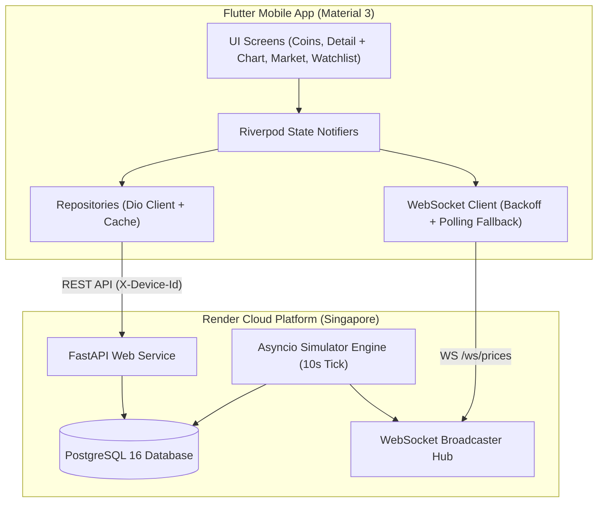

# CoinScope — Crypto Market App & Simulator

A high-performance mini CoinGecko-style crypto market intelligence app built with **Flutter** (Android/iOS) and a custom **Python FastAPI** backend powered by a realistic market price simulator and PostgreSQL database.

---

## Architecture Overview



---

## Render Deployment Guide (Step-by-Step)

The backend and database are pre-configured for **Render Free Tier** using the Infrastructure-as-Code Blueprint [`render.yaml`](./render.yaml).

### Step 1: Push Code to GitHub
1. Create a new repository on your GitHub account (e.g. `coinscope` or `Mini-CoinCrypto`).
2. Add the remote and push your code:
   ```bash
   git remote add origin https://github.com/<your-username>/<your-repo-name>.git
   git push -u origin main
   ```

### Step 2: Deploy Blueprint on Render
1. Sign in to your [Render Dashboard](https://dashboard.render.com).
2. Click **New +** in the top navigation and select **Blueprint**.
3. Connect your GitHub repository.
4. Render will detect [`render.yaml`](./render.yaml) and display the resources to be created:
   - **`coinscope-db`**: Free PostgreSQL database (Region: Singapore).
   - **`coinscope-api`**: Free Web Service running Python 3.12 (Region: Singapore).
5. Click **Apply**.
6. Render will:
   - Automatically provision PostgreSQL and inject `DATABASE_URL`.
   - Run `pip install -r requirements.txt`.
   - Execute `alembic upgrade head` to run all migrations.
   - Seed the database with 53 coins and 365 days of historical price points.
   - Launch Uvicorn on `$PORT` with background simulator and WebSocket streaming.

### Step 3: Verify Deployment
Once the deployment displays **Live**, test your service:
```bash
# Replace with your Render URL:
export API_URL="https://coinscope-api-xxxx.onrender.com"

# 1. Health check
curl $API_URL/health

# 2. Get top coins
curl "$API_URL/api/coins?per_page=5"

# 3. View global market stats
curl $API_URL/api/market/global
```

> [!NOTE]
> **Render Free Tier Cold Starts**:
> Render's free web services spin down after 15 minutes of inactivity. When a request wakes the service, CoinScope's startup backfill algorithm automatically calculates all missing 5-minute price points between the last stored timestamp and the current time using the stochastic price model. Charts will never display gaps. The Flutter app is pre-configured with a 60-second timeout and a "Waking up server..." status banner.

> [!WARNING]
> **Free PostgreSQL Expiry**:
> Render free PostgreSQL instances expire after 30 days. When you recreate or connect a fresh database, CoinScope's startup seeder is completely idempotent and will automatically repopulate the schema, 53 coins, and 1 year of historical data on the first boot.

### Step 4: Connecting the Flutter App
When launching or building the Flutter application, provide your live Render API URL using `--dart-define`:
```bash
flutter run --dart-define=API_BASE_URL=https://coinscope-api-xxxx.onrender.com
```

---

## Local Development (Without Docker)

### Prerequisites
- Python 3.12
- PostgreSQL (e.g. Homebrew PostgreSQL running on port 5432)

### Backend Setup
```bash
cd backend
python3.12 -m venv .venv
source .venv/bin/activate
pip install -r requirements-dev.txt

# Configure environment
cp .env.example .env

# Run database migrations
alembic upgrade head

# Run full test suite (29 tests)
pytest -v

# Start development server with auto-reload
uvicorn app.main:app --reload --port 8000
```
