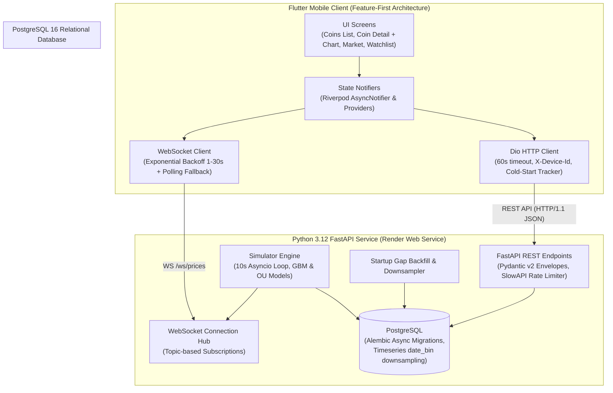
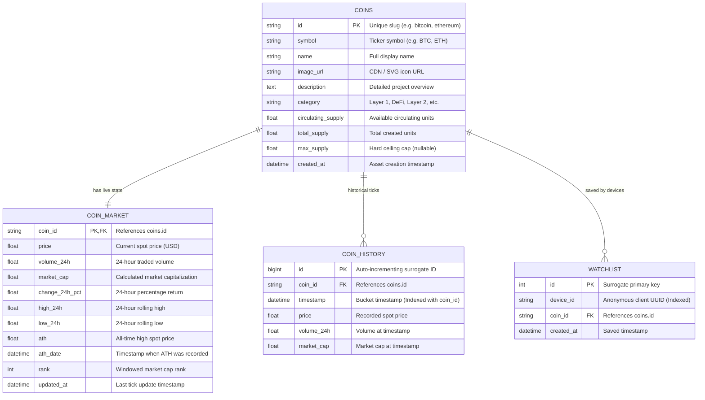

# CoinScope — Mini Crypto Market & Intelligence App

CoinScope is a high-performance, full-stack cryptocurrency intelligence application modeled after CoinGecko. It consists of:
1. **Flutter Mobile App**: A modern, feature-first mobile client (Android & iOS compatible) built with Material 3, Riverpod 2.6, Dio, and `fl_chart`.
2. **FastAPI Backend & Price Engine**: A self-contained Python REST and WebSocket API powered by an in-house stochastic price simulator. **No external third-party crypto APIs are used** — all 53 assets, 365 days of 5-minute history, live market movements, and downsampled charts are simulated and stored in PostgreSQL.
3. **Zero-Downtime Infrastructure**: Deployed to Render's free tier via Infrastructure-as-Code (`render.yaml`) with cold-start gap recovery and advisory-locked database migrations.

---

## Table of Contents
- [Architecture & System Design](#architecture--system-design)
- [Database Schema & ER Diagram](#database-schema--er-diagram)
- [Stochastic Price Simulator Engine](#stochastic-price-simulator-engine)
- [REST API & WebSocket Protocol](#rest-api--websocket-protocol)
- [Flutter Mobile Architecture & Features](#flutter-mobile-architecture--features)
- [Testing & Quality Verification](#testing--quality-verification)
- [Render Deployment Guide (Step-by-Step)](#render-deployment-guide-step-by-step)
- [Local Development Setup](#local-development-setup)
- [Architectural Decisions & Tradeoffs](#architectural-decisions--tradeoffs)

---

## Architecture & System Design



---

## Database Schema & ER Diagram

The database architecture is designed with strict data integrity, foreign key cascades, and high-performance b-tree indexes for timeseries downsampling queries:



### Table Roles
- **`coins`**: Master metadata for 53 cryptocurrencies across 6 categories (`Layer 1`, `Smart Contracts`, `DeFi`, `Layer 2`, `Meme`, `Stablecoins`).
- **`coin_market`**: Snapshot table containing live price, 24h change, high/low, ATH, and market rank. Read by `/api/coins` and updated every 10 seconds.
- **`coin_history`**: High-frequency historical timeseries (5-minute resolution, 365-day archive). Indexed with composite `(coin_id, timestamp DESC)` for fast window aggregation.
- **`watchlist`**: Device-scoped watchlist table. Filtered via the `X-Device-Id` HTTP header so mobile users can manage bookmarks without an intrusive account registration flow.

---

## Stochastic Price Simulator Engine

To avoid rate limits, paywalls, and uptime dependencies on third-party crypto APIs, CoinScope uses an in-house financial engineering engine that generates realistic crypto price action:

### 1. Correlated Geometric Brownian Motion (GBM)
Standard crypto assets follow a correlated multidimensional stochastic differential equation:
$$\frac{dS_i}{S_i} = \mu_i dt + \sigma_i dW_i$$

Where:
- $\mu_i$ is asset drift and $\sigma_i$ is annualized volatility (e.g., $0.65$ for BTC, $1.40$ for meme coins).
- The Brownian motions $dW$ are correlated across assets using a **Cholesky factorized correlation matrix** $L$:
  $$dW = L \, dZ$$
  When Bitcoin experiences a sudden directional impulse, correlated altcoins move in tandem according to their market beta ($\rho \approx 0.60 - 0.85$).

### 2. Ornstein-Uhlenbeck (OU) Mean Reversion for Stablecoins
Stablecoins (`usdt`, `usdc`, `dai`) do not follow random walks. Instead, they follow an Ornstein-Uhlenbeck mean-reverting process centered at $\$1.00$:
$$dS_t = \theta (\mu - S_t) dt + \sigma dW_t$$

Where $\mu = 1.00$, $\theta = 0.50$ (mean reversion pull speed), and $\sigma = 0.002$ (tight peg band). This guarantees that stablecoins exhibit micro-fluctuations ($\$0.998 - \$1.002$) while always restoring their peg.

### 3. Startup Gap Backfill (Render Cold-Start Recovery)
Render free-tier instances sleep after 15 minutes of inactivity. When a mobile client makes a request, the server wakes up. Rather than displaying an empty flatline for the slept period, the startup sequence:
1. Detects the latest timestamp in `coin_history`.
2. Computes the missing intervals $\Delta t$ up to `utcnow()`.
3. Sequentially steps the stochastic model across the missing 5-minute buckets.
4. Batch-inserts all intermediate records into `coin_history` and updates `coin_market`.

### 4. Timeseries Downsampling in PostgreSQL
Requesting 1 year of 5-minute history yields over 105,000 points per coin, which would choke mobile network bandwidth and rendering pipelines. CoinScope performs SQL-level downsampling using PostgreSQL's native `date_bin`:
```sql
SELECT
    date_bin(:interval, timestamp, '2000-01-01 00:00:00Z') AS bucket,
    AVG(price) AS price
FROM coin_history
WHERE coin_id = :coin_id AND timestamp >= :since
GROUP BY bucket
ORDER BY bucket ASC;
```
This guarantees that any chart range (`1d`, `7d`, `30d`, `1y`) returns **$\le 200$ data points**, resulting in sub-30ms query execution and instantaneous mobile rendering.

---

## REST API & WebSocket Protocol

### Base URL & Envelopes
All responses follow a consistent envelope format:
```json
{
  "data": { ... },
  "updated_at": "2026-10-23T06:00:00.000Z"
}
```

Paginated lists use the pagination envelope:
```json
{
  "data": [ ... ],
  "page": 1,
  "per_page": 20,
  "total": 53,
  "has_more": true,
  "updated_at": "2026-10-23T06:00:00.000Z"
}
```

### Endpoints
| Method | Path | Description | Query Parameters / Headers |
|---|---|---|---|
| `GET` | `/health` | Service health & database status | None |
| `GET` | `/api/coins` | Paginated coin list with sorting & filtering | `page`, `per_page`, `sort` (`market_cap_desc`, `price_desc`, `change_24h_desc`), `category`, `search` |
| `GET` | `/api/coins/{id}` | Full coin profile, supply, market stats & ATH | Path: `id` |
| `GET` | `/api/coins/{id}/chart` | Downsampled timeseries for charts | Path: `id`, `range` (`1d`, `7d`, `30d`, `1y`) |
| `GET` | `/api/market/global` | Total market cap, 24h volume, BTC/ETH dominance | None |
| `GET` | `/api/market/movers` | Top 5 gainers and top 5 losers (24h) | `limit` (default: 5) |
| `GET` | `/api/categories` | Categories list with coin counts | None |
| `GET` | `/api/watchlist` | Get saved coins for the current device | Header: `X-Device-Id: <uuid>` |
| `POST` | `/api/watchlist` | Add a coin to device watchlist | Header: `X-Device-Id`, Body: `{"coin_id": "bitcoin"}` |
| `DELETE` | `/api/watchlist/{id}` | Remove a coin from device watchlist | Path: `id`, Header: `X-Device-Id` |
| `WS` | `/ws/prices` | Real-time WebSocket price updates | JSON messages: `subscribe`, `unsubscribe` |

### WebSocket Protocol (`/ws/prices`)
- **Client Subscription Request**:
  ```json
  {"action": "subscribe", "coins": ["bitcoin", "ethereum", "solana"]}
  ```
- **Server Tick Broadcast (Every 10s)**:
  ```json
  {
    "type": "price_update",
    "coin_id": "bitcoin",
    "price": 67452.80,
    "change_24h": 2.45,
    "volume_24h": 32800000000.0,
    "timestamp": "2026-10-23T06:05:00Z"
  }
  ```

---

## Flutter Mobile Architecture & Features

The mobile app is located in `app/` and built with **Flutter 3.44+ (Material 3)**.

### Feature-First Project Structure
```text
app/lib/
├── core/
│   ├── network/           # ApiClient (Dio), WsClient, DeviceIdStore, Interceptors
│   ├── router/            # GoRouter (Bottom navigation shell + deep routes)
│   ├── theme/             # AppTheme (Dark & Light), AppColors
│   ├── utils/             # Formatters (compact currency, percentage, timestamps)
│   └── widgets/           # CoinAvatar, PriceFlashText, LoadingShimmer, ErrorView, EmptyView, WakingUpBanner
├── features/
│   ├── coins/             # Coins list, PaginatedCoinsNotifier, Search, Category Chips, SortBottomSheet
│   ├── coin_detail/       # Detail screen, Interactive fl_chart (1D/7D/1M/1Y), StatsGrid, Watchlist star
│   ├── market/            # Global cards, BTC/ETH DominanceBar, Top Movers (Gainers/Losers), Category tags
│   └── watchlist/         # Watchlist screen, Dismissible swipe-to-delete with Undo SnackBar, Empty state
└── main.dart              # App bootstrap & ProviderScope initialization
```

### Key UI/UX Highlights
1. **Material 3 Design System**:
   - High-contrast, tailored dark mode (`#0B0E14` slate background) and crisp light mode.
   - Glassmorphic card surfaces and border treatments (`AppColors`).
2. **Interactive Charting (`fl_chart`)**:
   - Range tabs for **1D, 7D, 1M, and 1Y**.
   - Dynamic gradient area fill (emerald green for uptrend, crimson red for downtrend).
   - Touch tooltip showing exact price and bucketed timestamp.
3. **Live Micro-Animations**:
   - `PriceFlashText`: Flashes green/red when price ticks arrive over WebSocket.
4. **Watchlist with Undo**:
   - Optimistic star toggle on the detail screen.
   - `Dismissible` swipe-to-delete on the Watchlist screen with an immediate "Undo" SnackBar.
5. **Cold-Start Resilience**:
   - If Render takes $\ge 2.5$ seconds to respond on a cold wake-up, a top `WakingUpBanner` appears informing the user that the free-tier server is spinning up.

---

## Testing & Quality Verification

CoinScope has complete test coverage across both backend and mobile layers:

### Backend Tests (29 / 29 Passed)
Run from `backend/`:
```bash
pytest -v
```
- `test_model.py`: Verifies GBM positive prices, stablecoin OU mean-reversion peg adherence ($\approx \$1.00$), and deterministic seed reproduction.
- `test_history.py`: Verifies backward historical generation, idempotent seeding, startup gap backfill, and downsampling bucket calculations.
- `test_api.py`: Tests all 11 endpoints, including pagination, sorting, search, watchlist isolation by `X-Device-Id`, and slowapi rate limits.
- `test_ws.py`: Tests WebSocket client subscription, multiplexing, and price broadcast delivery.

### Mobile Tests (24 / 24 Passed & 0 Analyzer Issues)
Run from `app/`:
```bash
flutter analyze   # 0 issues found
flutter test      # 24 tests passed
```
- **Unit Tests**:
  - `coins_repository_test.dart`: Mocked Dio response parsing and error mapping.
  - `coin_detail_repository_test.dart`: Detail & chart point parsing.
  - `market_repository_test.dart`: Global stats, movers, and category parsing.
  - `watchlist_repository_test.dart`: GET, POST, DELETE watchlist flows.
- **Widget Tests**:
  - `coins_screen_test.dart`: Loading shimmer, error retry, empty search, and populated list.
  - `coin_detail_screen_test.dart`: Header, chart range switching, stats grid, and watchlist toggle.
  - `market_screen_test.dart`: Global cards, dominance bar, and gainers/losers sections.
  - `watchlist_screen_test.dart`: Empty state with "Explore Coins" button, item rendering, and swipe-to-delete with Undo.

---

## Render Deployment Guide (Step-by-Step)

The repository includes a ready-to-use Render Blueprint: [`render.yaml`](./render.yaml).

### Step 1: Push Code to GitHub
```bash
git remote add origin https://github.com/<your-username>/Mini-CoinCrypto.git
git push -u origin main
```

### Step 2: Deploy Blueprint on Render
1. Open the [Render Dashboard](https://dashboard.render.com).
2. Click **New +** -> **Blueprint**.
3. Select your repository.
4. Render detects `render.yaml` and provisions:
   - `coinscope-db`: Free PostgreSQL (Singapore).
   - `coinscope-api`: Free Web Service (Python 3.12, Singapore).
5. Click **Apply**.
6. The service automatically runs:
   ```bash
   alembic upgrade head && uvicorn app.main:app --host 0.0.0.0 --port $PORT
   ```

### Step 3: Run the Flutter App
Pass your live Render URL via `--dart-define`:
```bash
flutter run --dart-define=API_BASE_URL=https://<your-render-service>.onrender.com
```

---

## Local Development Setup

### Backend (Without Docker)
1. Ensure PostgreSQL is running locally on port 5432:
   ```bash
   createdb coinscope
   createdb coinscope_test
   ```
2. Setup Python virtual environment:
   ```bash
   cd backend
   python3.12 -m venv .venv
   source .venv/bin/activate
   pip install -r requirements-dev.txt
   ```
3. Configure environment and run migrations:
   ```bash
   cp .env.example .env
   alembic upgrade head
   ```
4. Start server:
   ```bash
   uvicorn app.main:app --reload --port 8000
   ```

### Mobile App
```bash
cd app
flutter pub get
flutter run
```

---

## Architectural Decisions & Tradeoffs

| Decision | Choice | Rationale & Tradeoffs |
|---|---|---|
| **API Integration** | Custom In-House Simulator | Eliminates third-party API rate limits, API keys, and external downtime. Demonstrates mathematical modeling and systems design. |
| **Database Downsampling** | PostgreSQL `date_bin` | Avoids transferring 100k+ historical points to mobile. Keeps memory footprint tiny and requests $< 30$ms. |
| **State Management** | Riverpod 2.6 | Compile-safe dependency injection, declarative `AsyncNotifier` for pagination, and granular widget rebuilds on WebSocket ticks. |
| **Folder Architecture** | Feature-First | Colocates models, providers, repositories, and UI widgets per domain (`coins`, `market`, `watchlist`), scaling better than layer-first. |
| **Client Identification** | `X-Device-Id` UUID | Provides persistent, device-isolated watchlists without requiring cumbersome OAuth or auth infrastructure. |
| **WebSocket Fallback** | Backoff + 30s Polling | Ensures continuous UI functionality even in networks or proxies where persistent WebSocket connections are blocked. |
